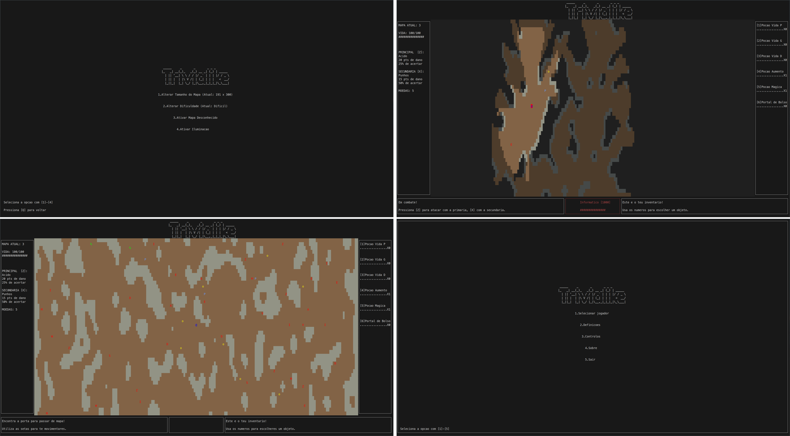

<!-- PROJECT LOGO -->
<br />
<div align="center">
  <h3 align="center">Trivial-Like LI2</h3>

  <p align="center">
    A fantastic copy of RogueLike developed in C. 
    <br />
    <br />
    <a href="#-demo">View Demo</a>
    &middot;
    <a href="#️-download--installation">Download Project</a>
    &middot;
    <a href="#-getting-started-with-development">Start Developing</a>
  </p>

<h4 align="center">
⭐ Don't forget to Starring ⭐
</h4>

  <div align="center">

[![C][C-badge]][C-url]

  </div>

  <div align="center">

![University][university-badge]
![Subject][subject-badge]
![Grade][grade-badge]

  </div>
</div>


<!-- TABLE OF CONTENTS -->
<details>
  <summary>📋 Table of Contents</summary>

## 📋 Table of Contents

- [About The Project](#-about-the-project)
- [Download & Installation](#️-download--installation)
- [Usage](#-usage)
- [Getting Started with Development](#-getting-started-with-development)
- [Contributing](#-contributing)
- [Developed by](#-developed-by)
</details>


## 🔍 About The Project

### 🎯 The goal

This project was developed for the LI2 University of Minho Subject of the Software Engineering degree.

As you can easily see on the demo, the goal was develop a clone of Roguelike game with ncurses library from C.

If you want, you can read the [project statement](enunciado.pdf) (in Portuguese).

### ⚙️ How it works?

We try to since the begin organize the code in a way that we could easily add new features, creating a very well modulated project, always splitting the events from the drawing functions.

### 🎬 Demo



https://github.com/Darguima/Trivial-Like-LI2/assets/49988070/bd3e1cbd-0621-4597-a22c-3aba0e414fc2

### 🧩 Features

* Players name (to continue the game after leaving it)
* Random map generation with dynamic size
* Vision system (that can be turned off), with lightning system
* Random enemies generation, with IA movement
* Random items generation
* Settings (that are persistent even after closing the game)
* Music


## ⬇️ Download & Installation

You can download the game on [project's releases](https://github.com/Darguima/Trivial-Like-LI2/releases).


## 📖 Usage

### Controls ⌨️ (Keyboard Only)

* **Arrows** - Move the player
* **q** - Enter Pause mode

###### The game controls are shown on the bottom of the screen, and shown when is possible to use them.


## 🚀 Getting Started with Development

To get a local copy up and running follow these simple example steps.

### 1. Prerequisites

Start by installing the following tools:

* [Git](https://git-scm.com/downloads) - Version Control System

### 2. Cloning

Now clone the repository to your local machine. You can do this using Git:

```bash
$ git clone git@github.com:darguima/trivial-like-li2.git
# or
$ git clone https://github.com/darguima/trivial-like-li2.git
```

### 3. Dependencies

Install the dependencies:

```bash
# Debian / Ubuntu / Mint
$ sudo apt-get install libncurses-dev build-essential libjson-c-dev

# Arch
$ sudo pacman -S sdl2_mixer
```

### 4. Building 

Compile and run the Code:

```bash
$ make

# Executing program
$ ./triviallike
```

If you want you have an helper that `clean`, `compile` and `execute` the project:

```bash
$ make dev
```

## 🤝 Contributing

Contributions are what make the open source community such an amazing place to learn, inspire, and create. Any contributions you make are **greatly appreciated**.

If you have a suggestion that would make this better, please fork the repo and create a pull request. You can also simply open an issue with the tag "enhancement".
Don't forget to give the project a star! Thanks again!

1. Fork the Project
2. Create your Feature Branch (`git checkout -b feature/AmazingFeature`)
3. Commit your Changes (`git commit -m 'Add some AmazingFeature'`)
4. Push to the Branch (`git push origin feature/AmazingFeature`)
5. Open a Pull Request


## 👨‍💻 Developed by

- [Afonso Pedreira](https://github.com/afooonso)
- [Dário Guimarães](https://github.com/darguima)
- [Hugo Rauber](https://github.com/HugoLRauber)
- [Rodrigo Macedo](https://github.com/rmufasa)


<!-- MARKDOWN LINKS & IMAGES -->
<!-- https://www.markdownguide.org/basic-syntax/#reference-style-links -->
[project-thumbnail]: [PROJECT_THUMBNAIL_PATH]

[university-badge]: https://img.shields.io/badge/University-Universidade%20do%20Minho-red?style=for-the-badge
[subject-badge]: https://img.shields.io/badge/Subject-LI2-blue?style=for-the-badge
[grade-badge]: https://img.shields.io/badge/Grade-19%2F20-brightgreen?style=for-the-badge

[C-badge]: https://img.shields.io/badge/C-00599C?style=for-the-badge&logo=c&logoColor=white  
[C-url]: https://en.wikipedia.org/wiki/C_(programming_language)
